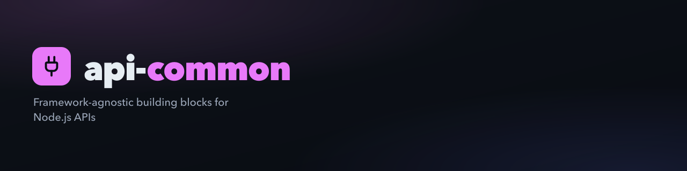

<!-- brand-kit:banner:start -->
<picture>
  <source media="(max-width: 640px)" srcset="./brand/banner-mobile.png">
  
</picture>
<!-- brand-kit:banner:end -->

<br>

[](https://github.com/rtorcato/api-common/actions/workflows/ci.yml)
[](https://badge.fury.io/js/@rtorcato%2Fapi-errors)
[](https://www.npmjs.com/package/@rtorcato/api-errors)
[](https://opensource.org/licenses/MIT)

[](https://buymeacoffee.com/rtorcato)

A monorepo of reusable Node.js library packages for building API projects. Targets Express, Hono, and other Node HTTP frameworks. Each package under `packages/` is independently consumable.

## Stack

- **pnpm** workspaces
- **TypeScript** (configs extend [`@rtorcato/repo-tooling`](https://www.npmjs.com/package/@rtorcato/repo-tooling))
- **Vitest** for tests
- **Biome** for lint + format
- **Husky** + **commitlint** (conventional commits) on commit
- **GitHub Actions** for CI + CodeQL, **Dependabot** for updates

## Packages

<!-- PACKAGES:START - generated by scripts/gen-readme-packages.mjs -->
| Import | Replaces | Description |
| --- | --- | --- |
| `@rtorcato/api-common/amqp` | `@rtorcato/api-amqp` | Typed amqplib publisher/consumer helpers for RabbitMQ — JSON encoding, exchange/queue assertion, and ack/nack handling. |
| `@rtorcato/api-common/auth` | `@rtorcato/api-auth` | Framework-agnostic JWT sign/verify helpers with Bearer-header and cookie token extraction. |
| `@rtorcato/api-common/auth/express` | `@rtorcato/api-auth-express` | Express middleware for @rtorcato/api-auth — JWT authentication with Bearer-header and cookie support. |
| `@rtorcato/api-common/auth/hono` | `@rtorcato/api-auth-hono` | Hono middleware for @rtorcato/api-auth — JWT authentication with Bearer-header and cookie support. |
| `@rtorcato/api-common/config` | `@rtorcato/api-config` | Load and validate environment variables with dotenv + zod for Node API projects. |
| `@rtorcato/api-common/cors/express` | `@rtorcato/api-cors-express` | Express CORS middleware with sane defaults (credentials, standard methods, preflight). |
| `@rtorcato/api-common/errors` | `@rtorcato/api-errors` | Framework-agnostic HTTP error classes for Node.js APIs. |
| `@rtorcato/api-common/errors/express` | `@rtorcato/api-errors-express` | Express middleware for @rtorcato/api-errors (error handler + not-found handler). |
| `@rtorcato/api-common/errors/hono` | `@rtorcato/api-errors-hono` | Hono middleware for @rtorcato/api-errors (error handler + not-found handler). |
| `@rtorcato/api-common/express-utils` | `@rtorcato/api-express-utils` | Small Express utility helpers: client IP extraction and route logging. |
| `@rtorcato/api-common/graceful-shutdown` | `@rtorcato/api-graceful-shutdown` | Framework-agnostic graceful shutdown for Node API servers — SIGTERM/SIGINT drain with ordered cleanup hooks and a hard timeout. |
| `@rtorcato/api-common/health` | `@rtorcato/api-health` | Framework-agnostic liveness/readiness health-check registry for Node API projects. |
| `@rtorcato/api-common/health/express` | `@rtorcato/api-health-express` | Express liveness/readiness probe handlers for @rtorcato/api-health. |
| `@rtorcato/api-common/health/hono` | `@rtorcato/api-health-hono` | Hono liveness/readiness probe handlers for @rtorcato/api-health. |
| `@rtorcato/api-common/http` | `@rtorcato/api-http` | Typed HTTP client over native fetch — base URL, default headers, timeout, and errors normalized to @rtorcato/api-errors. |
| `@rtorcato/api-common/logger` | `@rtorcato/api-logger` | Framework-agnostic pino logger factory for Node API projects. |
| `@rtorcato/api-common/mcp` | `@rtorcato/api-mcp` | Tiny result helpers for @modelcontextprotocol/sdk MCP servers. |
| `@rtorcato/api-common/openapi` | `@rtorcato/api-openapi` | Framework-agnostic OpenAPI 3.1 helpers — generate Scalar docs HTML from a spec object. |
| `@rtorcato/api-common/openapi/express` | `@rtorcato/api-openapi-express` | Express router that serves Scalar API docs from an OpenAPI spec object. |
| `@rtorcato/api-common/openapi/hono` | `@rtorcato/api-openapi-hono` | Hono adapter for schema-first OpenAPI docs — wires @hono/zod-openapi and serves the Scalar API reference UI. |
| `@rtorcato/api-common/rate-limit` | `@rtorcato/api-rate-limit` | Framework-agnostic sliding-window rate limiter for Node API projects, with a pluggable store (in-memory or Redis). |
| `@rtorcato/api-common/rate-limit/express` | `@rtorcato/api-rate-limit-express` | Express middleware for @rtorcato/api-rate-limit (sliding-window rate limiter). |
| `@rtorcato/api-common/rate-limit/hono` | `@rtorcato/api-rate-limit-hono` | Hono middleware for @rtorcato/api-rate-limit (sliding-window rate limiter). |
| `@rtorcato/api-common/rate-limit/redis` | `@rtorcato/api-rate-limit-redis` | Redis-backed store for @rtorcato/api-rate-limit — sliding-window limits shared across instances. |
| `@rtorcato/api-common/response` | `@rtorcato/api-response` | Consistent success-response envelope and zod schema helper for Node API projects. |
| `@rtorcato/api-common/security/express` | `@rtorcato/api-security-express` | Express security-headers middleware — a thin helmet wrapper with API-friendly defaults. |
| `@rtorcato/api-common/testing` | `@rtorcato/api-testing` | Test helpers for API projects: supertest re-export, JWT auth fixtures, and response assertion matchers. |
| `@rtorcato/api-common/timeout` | `@rtorcato/api-timeout` | Framework-agnostic per-request timeout for Node API projects — race a promise against a deadline and reject with a ServiceUnavailableError. |
| `@rtorcato/api-common/timeout/express` | `@rtorcato/api-timeout-express` | Express middleware for @rtorcato/api-timeout — fail a request with 503 if it isn't answered within a deadline. |
| `@rtorcato/api-common/timeout/hono` | `@rtorcato/api-timeout-hono` | Hono middleware for @rtorcato/api-timeout — fail a request with 503 if it isn't answered within a deadline. |
| `@rtorcato/api-common/ts-rest/express` | `@rtorcato/api-ts-rest-express` | Mount a ts-rest contract on Express and serve its OpenAPI docs (Scalar) — wires @ts-rest/express + @ts-rest/open-api into api-common. |
| `@rtorcato/api-common/upload/express` | `@rtorcato/api-upload` | Promise-based S3 file upload for Express via multer-s3 — public/private ACL, cache-control, deterministic keys, typed errors. |
| `@rtorcato/api-common/upload/hono` | `@rtorcato/api-upload-hono` | Promise-based S3 file upload for Hono — parses multipart via c.req.parseBody() and PUTs to S3; public/private ACL, cache-control, deterministic keys, typed errors. |
| `@rtorcato/api-common/validation` | `@rtorcato/api-validation` | Zod request validation helpers with pretty error formatting for Node API projects. |
| `@rtorcato/api-common/webhooks` | `@rtorcato/api-webhooks` | Framework-agnostic webhook signature verification (HMAC) for Node API projects. |
| `@rtorcato/api-common/webhooks/express` | `@rtorcato/api-webhooks-express` | Express webhook middleware for @rtorcato/api-webhooks — raw-body capture + HMAC signature verification. |
| `@rtorcato/api-common/webhooks/hono` | `@rtorcato/api-webhooks-hono` | Hono webhook middleware for @rtorcato/api-webhooks — HMAC signature verification over the raw body. |
<!-- PACKAGES:END -->

### Install

```sh
pnpm add @rtorcato/api-errors                       # error classes only
pnpm add @rtorcato/api-errors @rtorcato/api-errors-express express
pnpm add @rtorcato/api-errors @rtorcato/api-errors-hono hono
```

Per-package READMEs (on npm and in each `packages/*/README.md`) carry the usage examples.

### Use with AI

This repo ships a self-contained AI skill so coding agents use these packages correctly (base-vs-adapter split, framework peer-deps, the errors throw/handler contract).

**Any agent with the [`skills`](https://www.npmjs.com/package/skills) CLI** — install it in one command, straight from GitHub (no clone, no package install):

```sh
npx skills add https://github.com/rtorcato/api-common --skill api-common
```

**Claude Code** — install the self-hosted skill:

```sh
/plugin marketplace add rtorcato/api-common
/plugin install api-common@api-common
```

**Cursor / Copilot / Codex** — copy the rules from [`AGENTS.md`](./AGENTS.md) (the cross-tool convention many agents read). It's generated from [`skills/api-common/SKILL.md`](./skills/api-common/SKILL.md) — edit the SKILL, then `pnpm sync:agents` (CI's `check:agents` fails if they drift).

### Releases

Versioning + publishing is automated via [Changesets](https://github.com/changesets/changesets). To propose a release:

```sh
pnpm changeset           # describe what changed, pick affected packages + bump type
git commit -am "feat: …"
git push                 # merge the PR; nothing is published yet
```

Releases are batched. Closing a milestone, or dispatching the Release workflow, waits for approval in the `release` environment and then opens a "Version Packages" PR. Merging that PR bumps versions and writes per-package `CHANGELOG.md`, and the next approved run publishes to npm. The version merge redeploys the [docs site](https://docs.torcato.dev/api-common/) automatically (the `Deploy Docs` workflow runs on any `packages/**` change), so changelogs and the generated API reference stay current — no manual docs step. READMEs use unversioned install commands, so they only need editing when a package's API changes, not on every release.

## Commands

Run from the repo root.

```sh
pnpm install                              # install workspace deps
pnpm -r build                             # build every package
pnpm -r test                              # test every package
pnpm -r typecheck                         # typecheck every package
pnpm --filter <pkg-name> <script>         # run a script in one package
pnpm check                                # biome lint + format check
pnpm check:fix                            # biome lint + format autofix
```

## Adding a new package

Use the `/new-package` skill so the new package matches existing conventions (tsconfig extends, exports map, vitest config, scripts). Framework deps (Express, Hono) go in `peerDependencies` so consumers control the version.

The Packages table above is generated from each `package.json` — run `pnpm gen:readme` after adding a package or changing a `description`. CI (`pnpm check:readme`) fails if it's stale.

## Conventions

- Packages must be framework-agnostic where possible. Framework-specific helpers live in their own package (e.g. `api-errors` is generic, `api-errors-express` is the adapter).
- Public API is whatever a package's `exports` field exposes. Internal modules are not part of the contract.
- Conventional commits are enforced by commitlint.

## Roadmap & tasks

The roadmap lives in [Milestones](https://github.com/rtorcato/api-common/milestones); individual work is tracked as [Issues](https://github.com/rtorcato/api-common/issues). Reference issues from PRs with `Closes #NN`.
